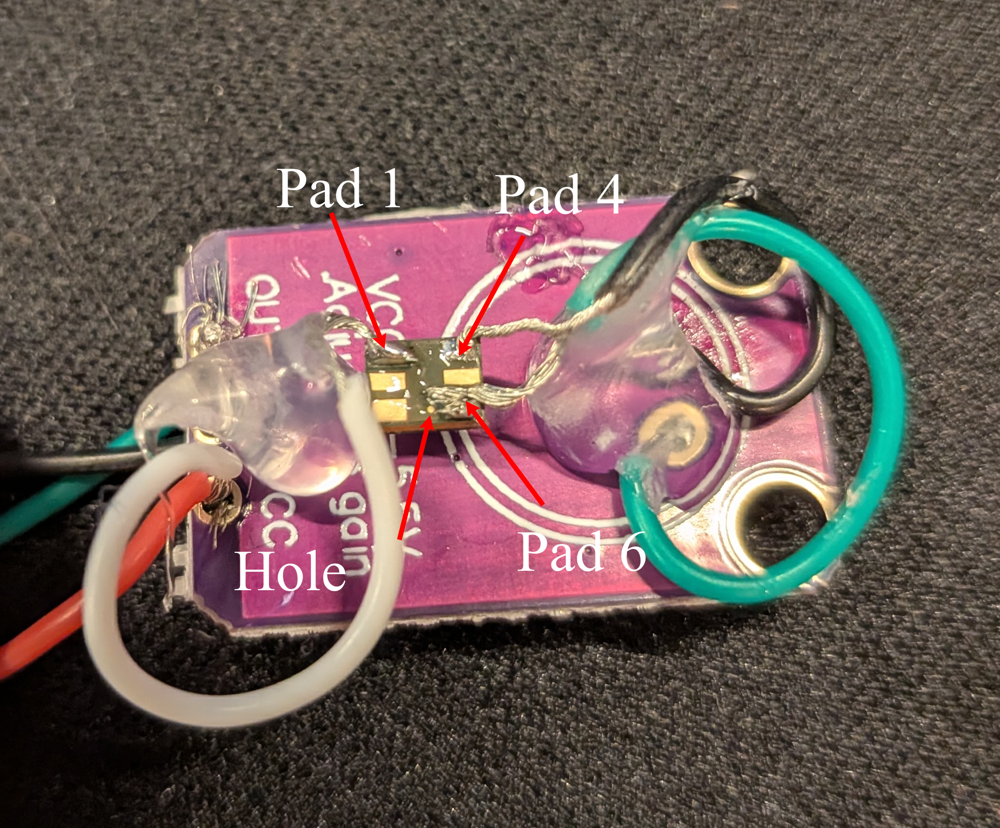
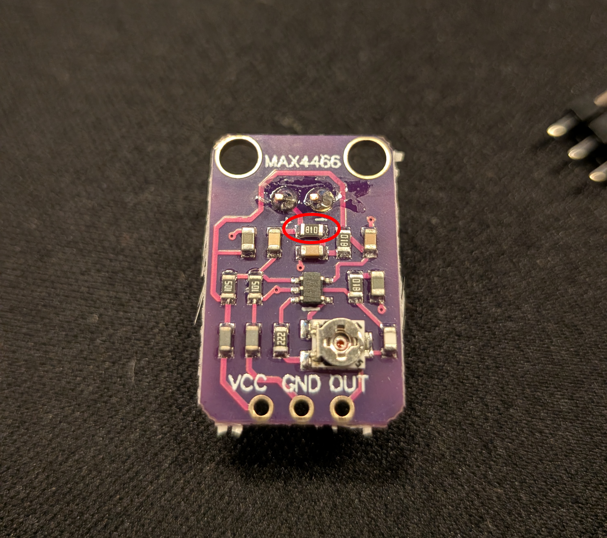
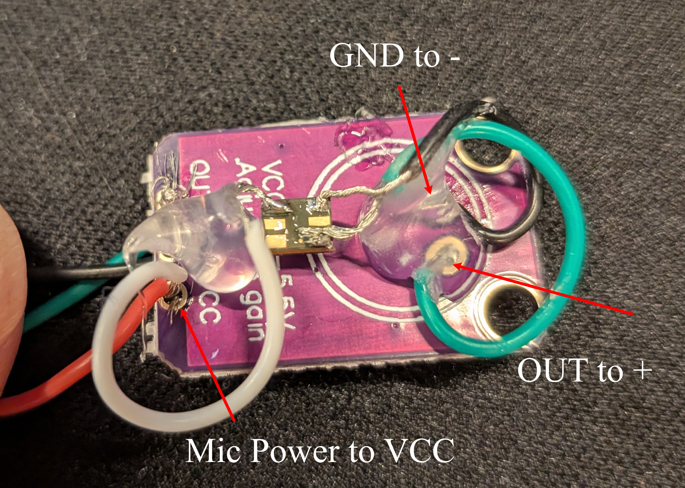
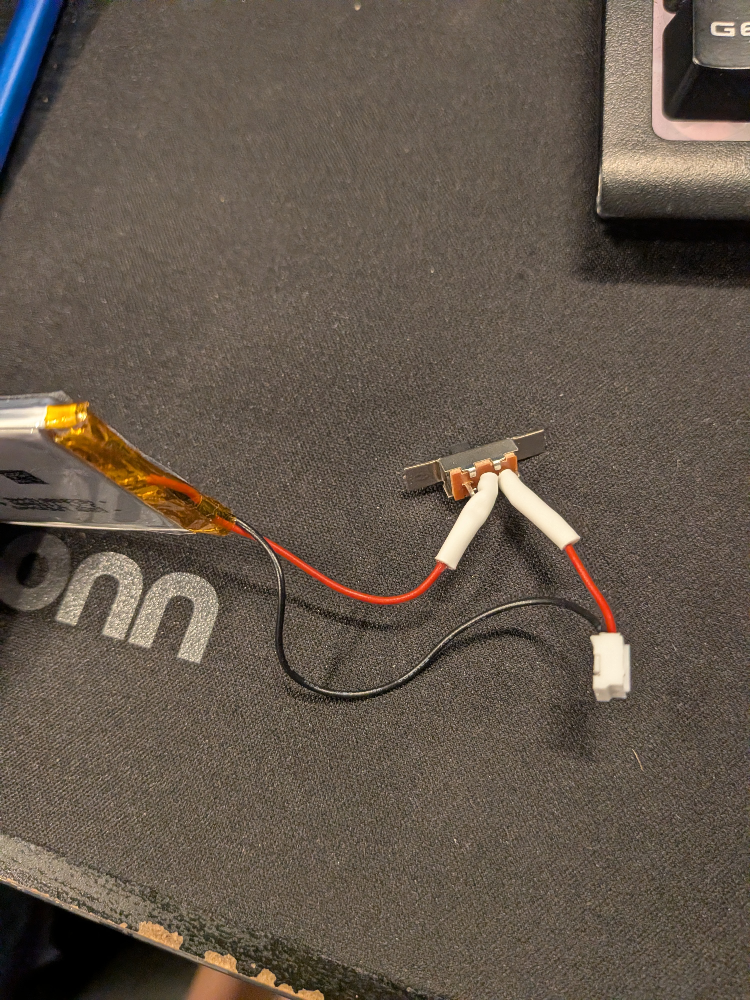
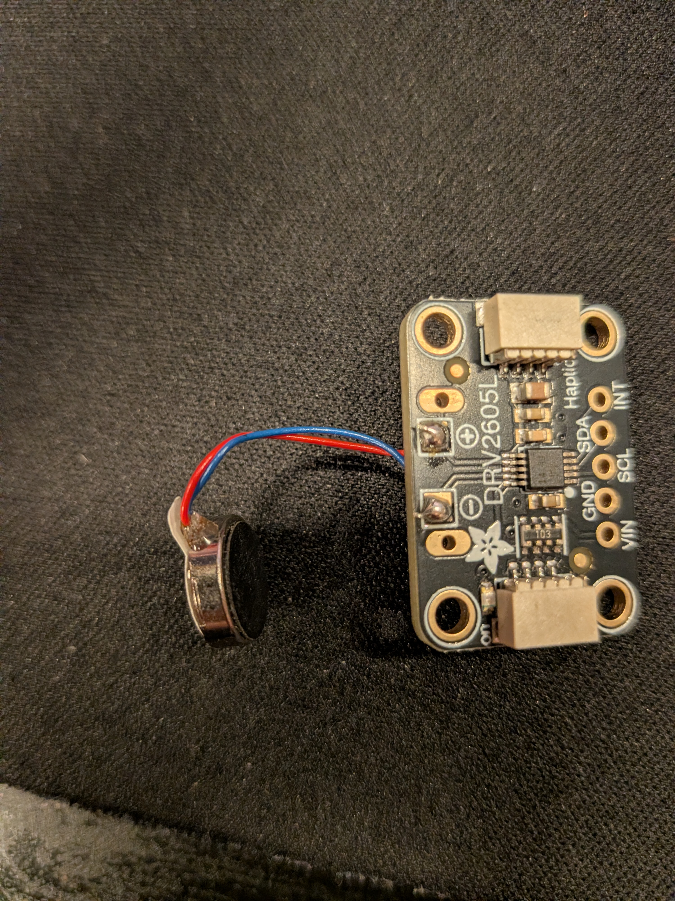
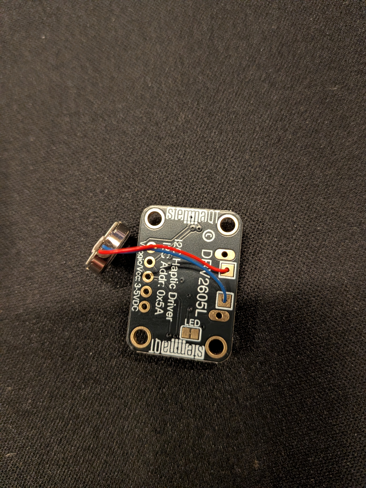
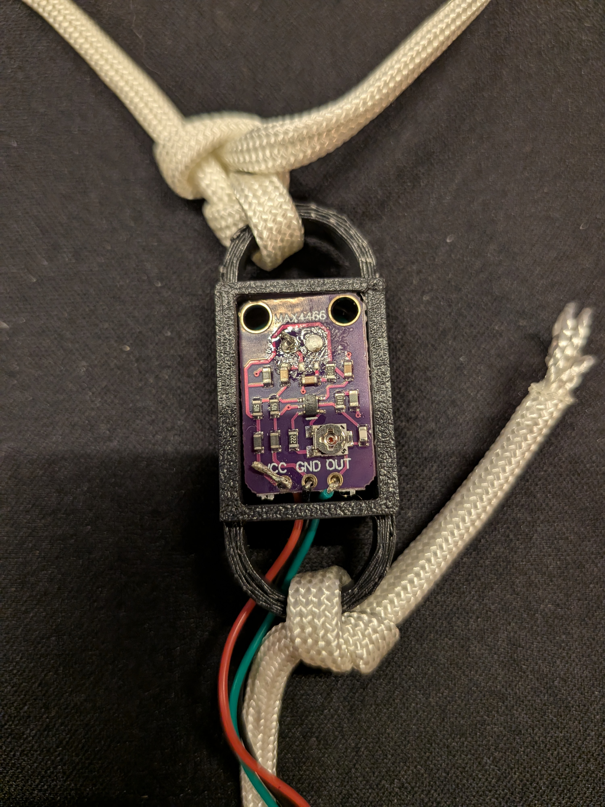
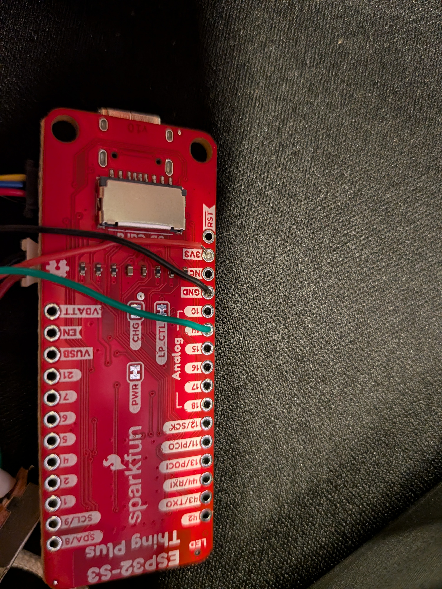
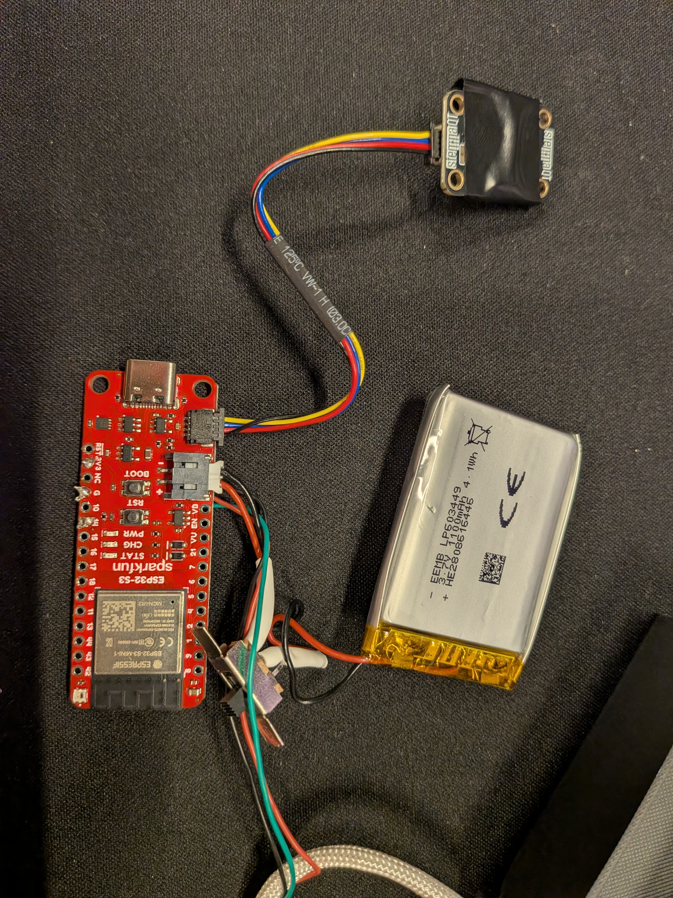

# Welcome to the Voice Trainer! 

This is a wearable device designed to monitor vocal frequency and provide haptic feedback when your pitch goes too low! It is built around bone-conduction sensing, the YIN pitch-tracking algorithm, and an ESP32-S3 microcontroller.

---

## Features
**Bone Conducting Microphone:** This project utilizes an awesome little bone conducting microphone (VMM-1627L-R) so that we can completely eliminate ambient noise.

**Low-Latency Pitch Tracking:** This project implements the autocorrelation-based YIN algorithm on the ESP32-S3 so it's pretty quick :) It has plenty of power to run this program but I have yet to see if it gets too hot :'(

**Haptic Feedback:** With the addition of a DRV2605L motor driver and the little coin motor with it, it can generate a variety of haptic feedback signals. If you want to customize it further to make different vibrations when you fall below the pitch you want, please see the customization section.

---

## Bill of Materials

 **SparkFun ESP32-S3 Thing Plus**: Really any ESP32-S3 that has USB-C, LiPo JST-PH 2.0mm with onboard charging, STEMMA-QT connector

 **VMM-1627L-R**  MEMS bone-conduction microphone capsule | Analog OUT, VDD, GND |
 https://www.digikey.com/en/products/detail/pui-audio-inc/VMM-1627L-R/17085367

 **MAX4466 Breakout**  Preamplifier with adjustable gain  Analog IN/OUT (Neck Node) 

 **Adafruit DRV2605L**  Haptic motor driver  I2C (Qwiic / STEMMA QT) 

 **ERM Coin Vibration Motor**  Tactile feedback actuator  Connected to DRV2605L. Also from Adafruit.

 **1100 mAh 1S LiPo Battery**  3.7V power cell w/ JST-PH 2.0mm (2-pin) 

 **30 AWG Magnet / Silicone Wire**  Used to connecte everything together.

 **Soldering Flux** This is a must.

**Solder** Need some to connect it all together haha.

**3-Prong Switch** Thats just what I ended up using but it doesn't really matter. Just needs to turn on and off!

**Heat shrink wrapping** Make sure to not get any short circuits

---
## Tools Required

**3D Printer** Any printer should do. Just have some PLA or PETG around.

**Soldering Iron** I recommend a high quality soldering station and some helping hands to hold everything together.

**Wire Strippers/Clippers** 

**Heat gun/Hair dryer** For heat shrink wrap

---

## Disclaimers
I am not an expert just a girl frustrated with not remembering to use my voice. I am also not very good at soldering nor an electrical engineer. If I can make this, so can you!

## Hardware Modifications & Wiring

### 1. Prepare the VMM-1627L-R

We are attaching jumpers to the pads of the microphone. We will solder it to the amp board in the next section.

Here is the datasheet (you will need it): https://puiaudio.com/file/specs-VMM-1627L-R.pdf

Pay close attention to the pad layout and how there is an identifiable dot closer to pads 6, 5, 4.

This is by far probably the most challenging part of the build. It requires patience and a steady hand but it is doable for anyone. Infact, I successfully did it on my first attempt. I recommend watching this video on 'dead bug soldering': https://www.youtube.com/watch?v=q53uPn1mKc0

I prepared a space on a piece of plywood and taped the VMM-1627L-R down into place but made sure to keep the top open. Orient it so you know which pads are on which side using the datasheet.

Flux is a **MUST**. I put a little bit of liquid flux into one of my used estrodial needles hahaha and squirted it onto the pads. I then followed the datasheet from here. I soldered a wire to pad 3 for power (VDD) and to pad 6 for the output (OUT). Any other pad can be used for ground. I ended up choosing pad 4 for my ground but it doesn't matter.

The image shows the mic wired up on the MAX4466 amplifier

After the pads are soldered on, make sure to secure it in place with some super glue or hot glue.

It is **CRUCIAL** you do not cover the relief hole on the other side of the microphone as this will destroy the microphone.

We will get into modifying the amplifier and attaching the microphone onto it next.

### 2. MAX4466 Preamplifier Modification
Stock MAX4466 breakout boards include a pull-up bias resistor designed for 2-pin electret capsules. Because the VMM-1627L-R is an active 3-pin MEMS microphone with its own internal buffer, the DC bias resistor must be removed:
* **Remove electret microphone** Desolder the microphone + and - pins and pop it out!
* **Remove Resistor R1:** Desolder or cut R1 connected to the positive input pad to decouple DC power from the audio input line.

It is easier to remove if you put a glob of solder on the tip and then cover it to remove it.
* **Solder on the VMM-1626L-R:** 
Its time to connect the VMM-1627L-R to the amplifier since it is ready!
We will solder the VMM OUT to the positive (+) and the VMM GND to negative (-). VMM power (VDD) will be hooked right up to the breakout board VCC

### 3. Battery Modification and Polarity Check

Before plugging your battery into the ESP32 board, it is imperative that you check the polarity of the JST plug to make sure the positive and negative match. If they do not, you **MUST** pop the pins out and swap their positions. You can use something small to pry the plastic up and pull the pins out. Make sure not to short it.

Next you should cut in the positive wire and solder in a switch. Put it on the middle and outer pin. It doesn't matter which one. Make sure to add your heat shrink wrap before soldering.

### 4. Haptic Motor Driver and Coin Motor Assembly
 This is thankfully very easy. Simply solder the red wire to the + and blue wire to the - on the DRV2605L board.

### 5. Final Assembly

Time to put it all together! Place the bone conducting mic/amplifier combo into the neck box. Thread the three wires through the hole in the side and then solder them into the pins on the ESP32. 

You will put power wire (red) to the 3.3v pin, ground (black) to GND, and the analog output (green) to pin 14.

Lastly, plug in everything you need! STEMMA QT and battery connectors to each part.

After all of this, it is time to throw it all into a case. I have a **VERY** rough 3D printed case so far but it works. I wouldn't be caught dead wearing it in public though :'(

Check out the 3D models for the case.

## Customization

### 1. Changing the Pitch Threshold

In order to adjust the pitch you want it to activate at, simply open up the arduino IDE and change line 12:

#define PITCH_THRESHOLD_HZ 175.0f

I just chose 175 because it is a bit lower than a female average minimum.

### 2. Changing the Haptic Feedback

To change the haptic feedback, Just change the number for the WAVEFORM on line 27.

#define WAVEFORM 47

 47 is the number for the strong buzz. Other interesting candidates could be 1 or 12. A click or triple click. Look up the library for various different haptic effects. There are many!

### 3. Make your own pretty case! <3

The current case design is a bit bland.

## Future Plans

### 1. Custom PCB for Mic/Amp

I think that this project would benefit greatly from a custom PCB, but I am sadly not an electrical engineer. I have working plans now for a neck node board. I just have to get the time to order it and see if it works. The plans are in the pcb/neck_node files.

### 2. Bluetooth/Phone integration

It would be nice for anyone who wants to change some setting on the fly to be able to. Maybe allow the pitch to be changed and the haptic feedback. I could also integrate data-tracking so you can follow your vocal pitch throughout the day. This is pretty low on the list of things I want done want the main functions to be rock-solid.
